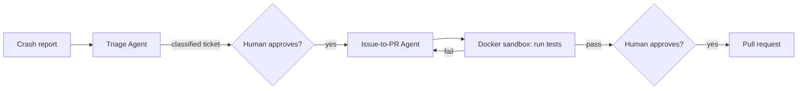

<div align="center">


<a href="https://github.com/INtruDerBoY">
  
</a>


</div>

---

## `whoami`

```kotlin
data class Developer(
    val name: String = "Utkarsh Singh",
    val role: String = "Mobile App Developer | Agentic AI | FastAPI",
    val education: String = "B.Tech CSE, CSJMU Kanpur (2023 - 2027)",
    val experience: String = "Android Developer Intern @ Codec Technologies",
    val buildsWith: List<String> = listOf("Kotlin", "Jetpack Compose", "FastAPI", "LangGraph"),
    val loves: List<String> = listOf("offline-first systems", "reliable agents", "clean architecture"),
    val currentlyBuilding: String = "Agent pipelines that find, triage, and fix bugs",
    val lookingFor: String = "SDE / Android / Agentic AI roles"
)
```

---

## Tech Arsenal

**Languages**


**Android and Backend**


**Databases and Tools**


**AI and Agents**


---

## Featured Projects

| Project | What it does | Stack |
|---|---|---|
| **[Issue-to-PR Agent](https://github.com/INtruDerBoY?tab=repositories)** | Turns a GitHub issue into a reviewed pull request: finds the code, writes a patch, tests it in a network-isolated Docker sandbox, retries on failure, and waits for human approval | LangGraph, FastAPI, Docker, pytest |
| **[Crash and Bug Triage Agent](https://github.com/INtruDerBoY?tab=repositories)** | Classifies, deduplicates, and root-causes mobile crash reports with parallel analysis and human-in-the-loop approval | LangGraph, FastAPI, ChromaDB |
| **[BlueChat](https://github.com/INtruDerBoY?tab=repositories)** | Serverless Android messenger over Bluetooth RFCOMM with AES-256 encryption, chunked file transfer, and auto-reconnect | Kotlin, Compose, Room, Coroutines |
| **[VidyaRoom](https://github.com/INtruDerBoY?tab=repositories)** | AI lecture platform with live transcription, translation, doubt resolution, and teacher analytics | Next.js, FastAPI, PostgreSQL, Whisper, Gemini |

### How my agents connect



---


---

## Achievements

- Finalist and **Best Approach Award**, CSJMU IBM BOB HACKS '26
- CodeChef Pro: Data Structures and Algorithms certification
- 500+ problems solved on LeetCode and GFG
- Student Placement Cell Coordinator and Joint Secretary, Hostel Council

---

## GitHub Stats

<div align="center">


</div>

---

## Let's Connect

<div align="center">

[](YOUR_LINKEDIN_URL)
[](mailto:YOUR_EMAIL)
[](YOUR_LEETCODE_URL)
[](YOUR_CODECHEF_URL)

*"Build it reliable first, then make it fast."*


</div>
